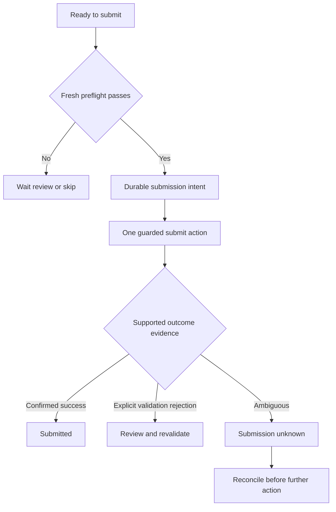

# V4 Guarded Autonomous Application Submission

Milestone V4 maps to the earlier V0.4 release. Depends on reliable V2 state/recovery and admitted V3 interpretation. Shared contracts remain mandatory. Real submission is explicitly opt-in.

## 1 What V4 will achieve

For a proven and allowlisted form variant, the system can submit an intended truthful application under explicit candidate permission, recognize affirmative confirmation, persist the outcome, and stop when it cannot determine what happened. It does not promise exactly-once execution on an external ATS that provides no shared idempotency mechanism.

The useful behavior is safe completion with clear uncertainty. More aggressive clicking or a second general-purpose model does not solve a network response lost after the ATS has accepted an application.

## 2 Entry conditions

Require real readiness evidence on the variant, V2 duplicate/recovery checks, versioned current facts, inspected resume artifacts, V3 benchmark report for any admitted model stages and adapter-specific success/validation observations. Audit current `submit` or `next` actions for hidden side effects before adding a new command.

Implement offline guard/reconciliation tests first. A roadmap or an ARD is not an instruction to submit actual applications. Honor explicit authorization already given for targets/configuration; do not ask again when that scope is clear. Missing authorization leaves real trials pending while reversible implementation/testing proceeds.

## 3 Scope and default controls

Required: disabled-by-default submission feature, explicit allowlist, per-run and persistent daily caps, authorization snapshot, fresh preflight, durable SUBMITTING intent, one guarded action, affirmative success detection, SUBMISSION_UNKNOWN, reconciliation and emergency disable. Restrict initially to Greenhouse and Lever variants already proven.

Deferred: universal browser agent, blind retries, unrestricted job volume, CAPTCHA bypass, inferred legal certifications, outreach sending, automatic Workday enablement and any model-controlled submission permission.

Configuration must distinguish permission, supported capability and operational caps. They are separate checks. A supported adapter is not authorization; permission does not make an unknown form supported. Persist caps across process restarts and specify the timezone used for the daily limit.

## 4 Submission preflight

Create a fresh PreflightReport for the current page and record:

- Current target employer, stable job ID, official application URL and adapter variant.
- Current JD/profile/policy versions and approved eligibility result.
- Expected plan and artifact hash, inspected attachment and current control readback.
- Required-field completeness, unresolved conflicts, verification and unsupported controls.
- Explicit consent/attestation answer authority where needed.
- Unique application record, no confirmed or ambiguous prior submission, and owned lease.
- Config/authorization allowlist, cap budget, user opt-in and feature-disable status.

Bind authorization to the candidate and intended target scope. Recheck immediately before action. A changed JD, sensitive fact, required question, artifact or target invalidates preflight. Config changes can remove permission while a browser is open; the final guard must observe that.

An attestation that information is accurate is a consequential declaration. Do not infer permission to check it from generic auto-fill or a resume file. The candidate must have supplied an explicit compatible answer/authorization for that field. Verification pauses for human action.

## 5 State and action protocol

Persist attempt ID, preflight hash, authorization snapshot, prior/next revisions and state SUBMITTING before the click. If that write fails, do not act. Record action/outcome observations afterward. Only the workflow owner can call the adapter's submit capability; semantic providers never receive that capability.

A browser crash after durable intent becomes SUBMISSION_UNKNOWN on recovery, even if the last local event suggests the click may not have occurred. Local logs do not necessarily prove remote acceptance or nonacceptance. Do not create a new attempt or click again automatically.

An explicit, adapter-understood server validation rejection can lead to review, field correction and a new preflight. Distinguish it from generic timeout/error/redirect behavior. A successful HTTP status or thank-you phrase elsewhere on a page does not establish acceptance for this candidate/job. Confirmation must be tied to the current application action and supported response state.

## 6 Confirmation and reconciliation

Each adapter defines affirmative confirmation signals, known validation failures and ambiguous cases based on observed behavior. Store redacted confirmation evidence, timestamp, adapter revision and application/attempt reference. Set `submittedAt` only after acceptance is confirmed.

For an unknown outcome, keep the record blocked from another submission. Possible reconciliation sources are a supported confirmation page/session, candidate-provided confirmation receipt, a verified application status, or an explicit human review decision supported by evidence. Do not guess that absence of a receipt means the form failed. Preserve provenance when the candidate submitted manually outside the workflow.

If non-submission can be reliably established and a retry is authorized, record the reconciliation and new attempt. If not, remain waiting. The software should present the uncertainty plainly with job URL, attempt time and evidence, without pressuring the user to resubmit.

## 7 Duplicate prevention and concurrency

Use the stable application key and a unique active record. Acquire application ownership before opening a submission path. Count attempt cap reservations transactionally with submission intent or an equivalent tested single-writer mechanism. Release a reservation only under a declared policy; a restart must not reset the daily count or free an ambiguous attempt automatically.

Repeated runs skip confirmed submissions and pause unknown ones. Reapplications require explicit distinct authorization and a retained history. Similar job titles do not justify deduping different requisitions. Candidate actions outside the agent should be reconciled into the record before another automatic run.

Begin at concurrency one. A task to submit more jobs is not a reason to increase profile concurrency before browser isolation and cap accounting are proven.

## 8 Models and algorithms

Reuse the selected V3 extraction/field/retrieval providers. They may propose interpretations but cannot authorize a click. There is no submission LLM and no model probability that overrides incomplete required fields, false eligibility, stale facts or verification.

Core algorithms are typed transitions, fresh invariant checking, version/fingerprint comparison, durable action intent, unique ownership and reconciliation. Prefer explicit adapter confirmation signals to a generic language-model reading of a screenshot. An optional model can summarize evidence for a user, but its summary is not authoritative confirmation.

Fuzzy labels and DOM similarity remain hints for known ordinary controls. Do not enable automatic submission on a new portal because its DOM resembles a proven form. If tree-based alignment is investigated, run it as a disabled proposal layer and measure control/meaning alignment on held-out variants before admission.

## 9 Offline E2E submission tests

Extend the local ATS fixture server with a real multipart upload endpoint, guarded submit endpoint, validation failures, confirmation tokens/pages and controlled response loss. Use only synthetic candidate data. Server-side request counts and ledger inspection are independent oracles.

| Test ID | Trigger | Required oracle |
|---|---|---|
| V4-E01 | autoSubmit false on otherwise complete form | Zero submit requests; READY_TO_SUBMIT persists |
| V4-E02 | Enabled but employer/job/variant not allowlisted | Zero submit; reason identifies failed guard |
| V4-E03 | Valid authorized fixture submission | Exactly one request; correct payload/hash; SUBMITTED with evidence |
| V4-E04 | Required answer missing or conflicting | Zero request; durable user-review task |
| V4-E05 | Artifact, JD or candidate version changes after readiness | Preflight invalidated; zero request |
| V4-E06 | Verification appears before action | Pause; no bypass and no request |
| V4-E07 | Storage write fails before intent | Zero request; STORAGE_FAILED |
| V4-E08 | Server accepts then response disappears | One request; SUBMISSION_UNKNOWN; restart never sends a second |
| V4-E09 | Process killed after intent before known outcome | Recovery blocks further submit until reconciliation |
| V4-E10 | Supported explicit validation error | No false success; corrected fields need fresh preflight |
| V4-E11 | HTTP 200 without supported confirmation | Unknown outcome, not SUBMITTED |
| V4-E12 | Unrelated thank-you text or wrong job confirmation | Confirmation rejected; no false success |
| V4-E13 | Two processes attempt the same application | One owned action path; unique active record |
| V4-E14 | Daily/run cap reached and process restarts | Cap preserved; no extra request |
| V4-E15 | User disables submission while form is open | Final guard observes removal; zero request |
| V4-E16 | Rerun a confirmed application | No new submit; prior confirmation retained |
| V4-E17 | Candidate provides receipt for unknown attempt | Supported human reconciliation to submitted; no repeat action |
| V4-E18 | Attestation has no explicit compatible authority | Pause; no silent checkbox approval |
| V4-E19 | New DOM resembles allowlisted form but questions differ | Unsupported/changed variant; no submit |
| V4-E20 | Submission intent persists but artifact disappears | No newly authorized action on recovery; review required |

Run V1 to V3 suites unchanged. Ordinary tests must not reach a real ATS. Testing “exactly one request” locally validates the client's behavior in that controlled scenario, not exactly-once guarantees for every remote system.

## 10 Live trial policy and release gate

Use actual distinct applications the candidate intends to submit, with explicit scope/permission. Never send synthetic applications to real employers to generate test traffic. Start with one supervised submission, inspect actual acceptance, add a sanitized confirmation fixture, then expand within configured caps.

Target at least 30 supervised authorized trials per enabled ATS over normal operation, with at least 27 affirmatively confirmed submissions. Report all pauses, failures, unsupported forms and unknown outcomes in the broader attempted pool. Do not duplicate applications to reach the target quickly. If an ATS lacks enough real trials, its live automation gate remains provisional/disabled as declared.

Any fabricated claim, wrong sensitive answer, unauthorized target, duplicate submission or blind retry blocks release and requires a fix plus relevant regression tests. Every ambiguous outcome must pause. Verify caps, disable controls and resume behavior with local failure injection; do not deliberately crash real submissions as an experiment.

## 11 Agent decisions and work order

First audit existing side-effect controls and confirmation behavior. Implement disabled guard/preflight; test durable intent and cap accounting; implement one ATS confirmation detector; test ambiguity/reconciliation; obtain authorized live evidence; repeat for the second proven variant.

Compare adapter signals versus generic DOM/LLM inference; transaction-based intent versus current durable single-writer mechanism; keep-open supervision versus reopened reconciliation; fixed per-run limits versus persistent daily caps. Reject apparent speed gains that hide uncertainty. Document what remote guarantees remain unavailable.

Deliver authorization/config schema, state/intent protocol, adapter confirmation registry, local E2E request-count results, live confirmation evidence, cap/disable checks, unknown-outcome queue and next operational bottleneck. Autonomous means explicitly bounded action with honest uncertainty.
